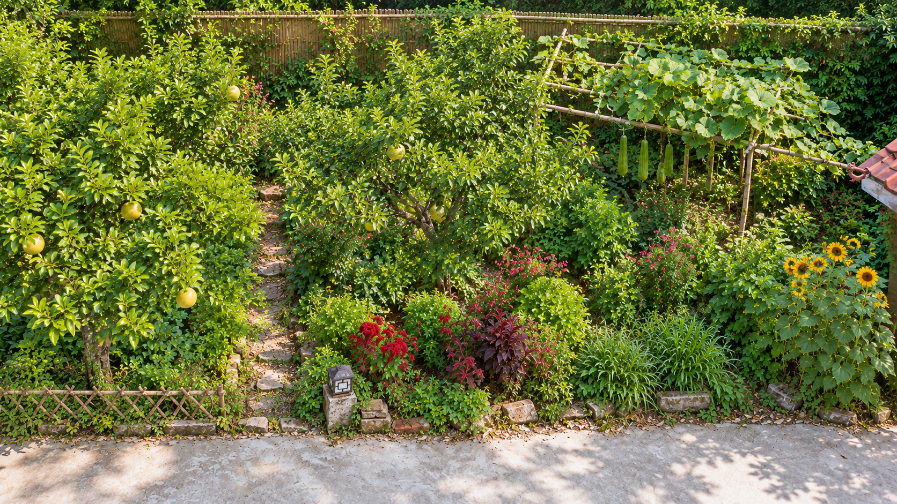
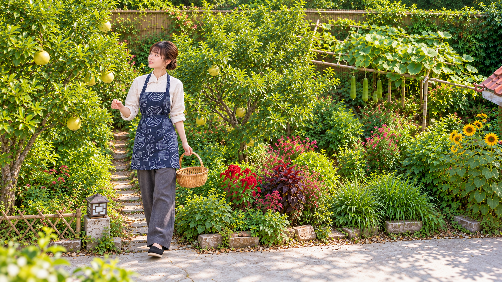
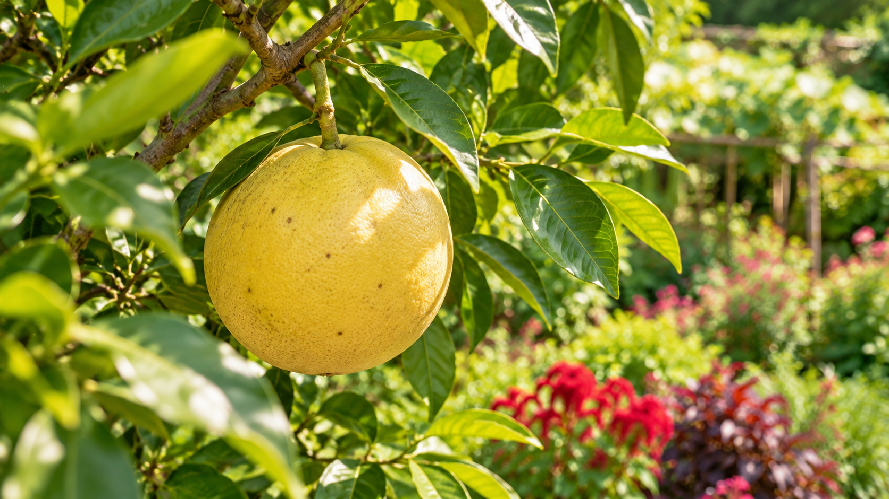
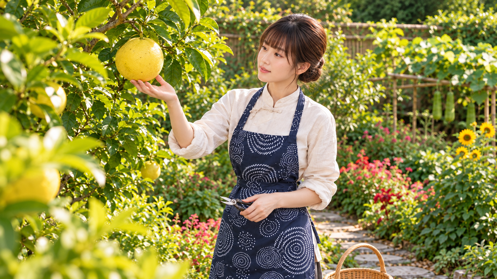
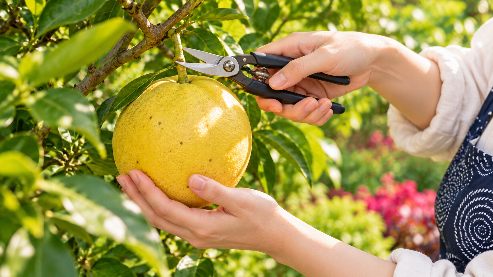
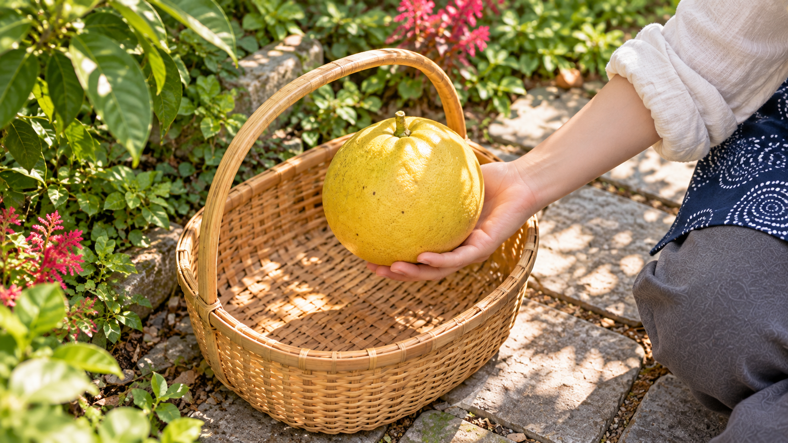
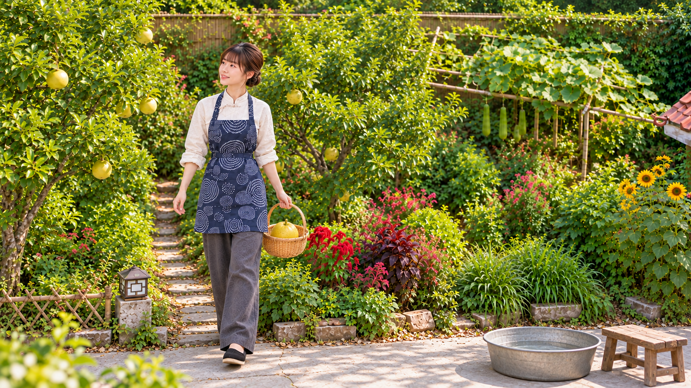
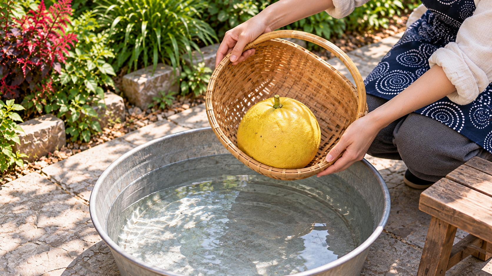
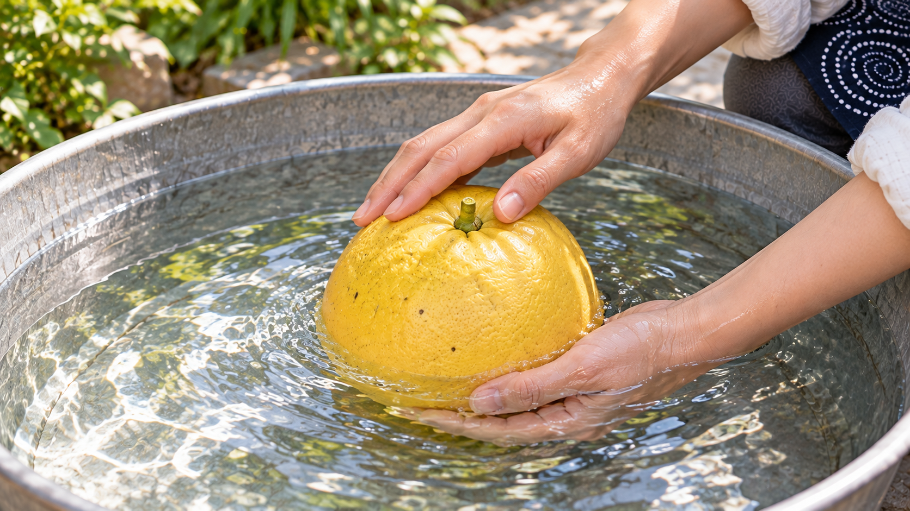
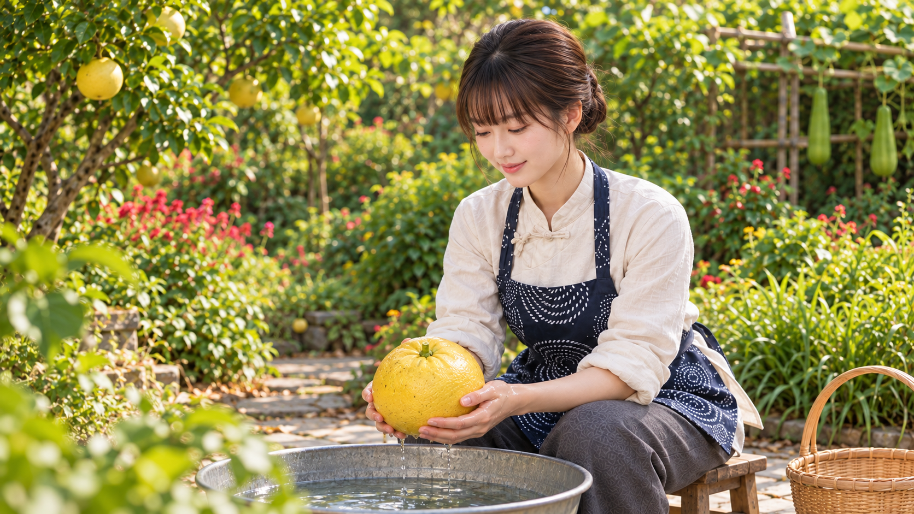

# Test 02 — Cô gái và khu vườn, 30 giây

**10 cảnh × 3 giây.** Theo yêu cầu ngày 12/10/2026: chỉ cô gái và vườn đã duyệt, tạm chưa thêm bà.

Đã chuẩn bị **10 ảnh PNG riêng** và kịch bản. S01 giữ nguyên ảnh vườn duyệt; S02–S10 được tạo từ bộ tham chiếu. Chưa sinh video trên Dola.

| Tệp | Nội dung |
|---|---|
| [Kịch bản / bảng cảnh](Shot_list_30s.md) | Mốc thời gian, trạng thái đầu, hành động, trạng thái cuối, cỡ/góc và âm thanh từng cảnh. |
| [Câu lệnh Seedance](Seedance_30s.md) | Đoạn 30 giây, phương án hai nhóm 15 giây và câu lệnh từng cảnh. |
| [10 ảnh đầu cảnh](images/) | S01.png–S10.png, mỗi ảnh một cảnh; cùng kích thước 1672 × 941 px theo nguồn, gần 16:9. |
| [Ảnh duyệt gốc](references/) | Hai ảnh cô gái và hai hướng nhìn của vườn, giữ nguyên byte. |
| [Dữ liệu cảnh](shotlist.json) | Bản máy đọc, tổng 30 giây, mỗi cảnh mẫu 3 giây. |
| [Mã kiểm ảnh](image_manifest.json) | Kích thước, SHA-256 và SHA blob Git của 14 mục ảnh/nguồn. |
| [Câu lệnh tạo ảnh](Cau_lenh_tao_anh.md) | Các câu lệnh thực dùng để tạo/chỉnh S02–S10; S01 dùng nguồn đã duyệt. |

Chuỗi: **vườn → tới cây → nhìn quả → kê đỡ → cắt cuống → đặt rổ → mang ra sân → nghiêng vào nước → rửa → nhìn thành quả**.

Nông sản thử là quả tròn vỏ vàng sẵn trong ảnh vườn; không thêm táo hoặc loại cây mới. Theo dõi một quả để đọc rõ trạng thái vật liệu. Rổ tre, chậu kim loại và ghế thấp là đồ dùng của bài thử; chậu/ghế đặt tạm trên sân ngoài mép luống.

**Lưu ý khi dựng:** 3 giây là độ dài cảnh được dùng. Nếu Dola chỉ sinh đoạn dài hơn, lấy phần 2,9–3,0 giây rõ hành động nhất. Mốc trong câu lệnh nhiều cảnh cần kiểm ở video đầu ra. Không có bà trong test này; thiết lập cô gái sống với bà ở [định hướng dự án](../../Dinh_huong_chinh_thuc.md) vẫn được giữ.

## Xem ảnh theo thứ tự

### S01 · 0–3 giây · Lá và cành nhỏ lay nhẹ trong gió.

### S02 · 3–6 giây · Bước nhỏ tới cây quả, rổ trống đung đưa rất nhẹ.

### S03 · 6–9 giây · Lá cạnh quả lay nhẹ; máy giữ yên.

### S04 · 9–12 giây · Kê/nâng đáy quả rất nhẹ để đỡ trọng lượng, khoảng 1 cm.

### S05 · 12–15 giây · Khép kéo một lần để cắt cuống; tay đỡ chịu trọng lượng quả.

### S06 · 15–18 giây · Hạ chính quả đó xuống rổ, nhả tay nhẹ.

### S07 · 18–21 giây · Đi một bước nhỏ về phía chậu rửa.

### S08 · 21–24 giây · Nghiêng rổ thêm chút để một quả lăn nhẹ vào chậu.

### S09 · 24–27 giây · Xoa một đường nhẹ trên vỏ để rửa.

### S10 · 27–30 giây · Nâng quả thêm vài cm và nhìn thành quả với nụ cười nhẹ.

## Bộ nguồn đã được người dùng duyệt

- REF_01.png: ảnh toàn thân cô gái, tên gốc “2.3. Ảnh ChatGPT 17_05_36 10 thg 10, 2026-3.png”.
- REF_02.png: “Góc nhìn ngược qua vườn xanh.png”.
- REF_03.png: “Khu vườn xanh nhìn từ trên cao.png”; dùng nguyên làm S01.
- REF_04.png: bảng nhiều góc cô gái, tên gốc “2. Ảnh ChatGPT 17_05_33 10 thg 10, 2026-1.png”.

