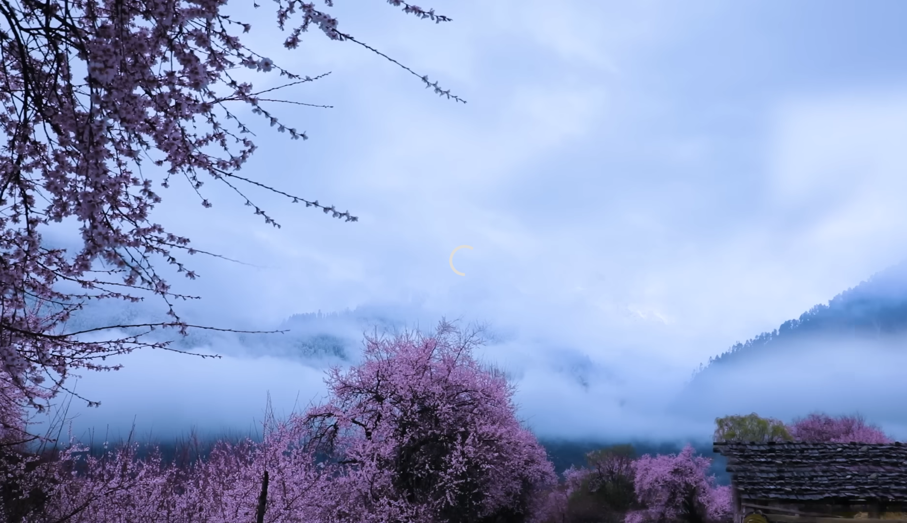
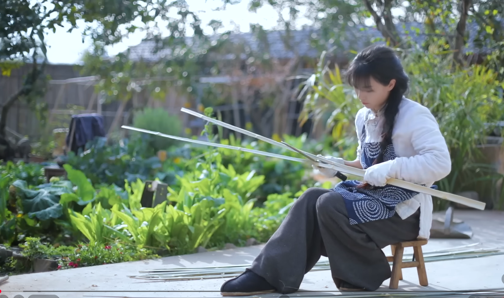
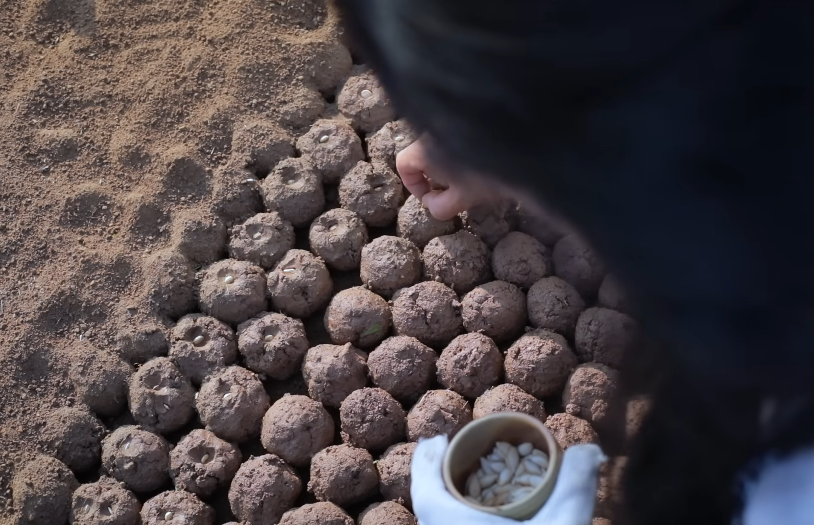
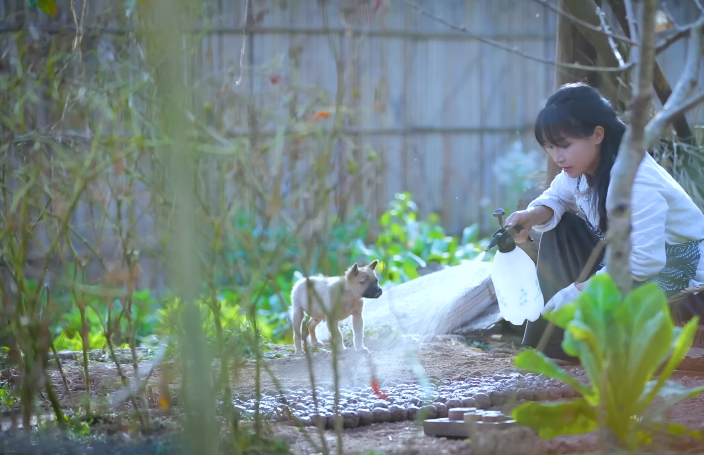

# VID 01 — Điểm hay trong ngôn ngữ điện ảnh của video Lý Tử Thất

**Dự án:** Nghiên Cứu LTT / Farm. **Ngày:** 12/10/2026. **Cơ sở:** shot list 471 cảnh do người dùng cung cấp, ba sheet và 12 ảnh tĩnh nhúng. Đây là phân tích tài liệu và ảnh; chưa xem độc lập toàn bộ video chuyển động hoặc nghe audio.

Luận điểm chính: cách tổ chức hình ảnh khiến lao động trở thành một hành trình có thể theo dõi và có kết quả. Cảnh quan mở ra thế giới; thao tác cho thấy năng lực; nông sản và món ăn làm thành quả hiện hữu; người thân và khách cùng hưởng thành quả tạo phần thưởng cảm xúc. Vẻ đẹp nằm cả ở từng khung hình lẫn quan hệ giữa các cảnh.

Trong báo cáo, “theo bảng” chỉ dữ liệu/mô tả từ workbook; “từ ảnh” chỉ quan sát trực tiếp 12 ảnh; “diễn giải” chỉ nhận định về tác dụng kể chuyện. Mọi timecode giữ theo bảng. Xem [QA dữ liệu](Qa_du_lieu.md) trước khi sử dụng các trường kỹ thuật để tái dựng.

## 1. Bức tranh toàn phim

Hai sheet chính đều có Shot 001–471. Mô tả giữa hai sheet trùng nhau hoàn toàn. Các khoảng thời gian liên tục, thời lượng từng dòng khớp đầu–cuối.

| Chỉ số theo bảng | Giá trị | Ý nghĩa khi đọc phim |
|---|---:|---|
| Tổng thời lượng | 22 phút 44,44 giây | Một hành trình gồm nhiều mùa và nhiều công đoạn được nén vào một video. |
| Số cảnh | 471 | Mật độ cảnh lớn, thường chuyển sự chú ý sang một chi tiết mới. |
| Thời lượng trung bình | 2,90 giây/cảnh | Cảm giác sống chậm vẫn có thể đi cùng nhịp cắt nhanh. |
| Trung vị | 2,80 giây | Một nửa số cảnh dài không quá 2,80 giây. |
| Cảnh từ 2 đến dưới 4 giây | 332/471, khoảng 70,5% | Khoảng thời lượng phổ biến cho một đơn vị thông tin ngắn. |
| Cảnh dưới 1 giây | 22/471 | Có những cụm thao tác được nén rất mạnh. |
| Cảnh dài nhất | Shot 010, 8,36 giây | Dành thời gian cho việc tưới cùng sự hiện diện của chó nhỏ. |

**Điểm cần học:** nhịp yên bình không buộc mỗi shot phải dài. Khi công việc, không gian và mục tiêu đều rõ, chuỗi cảnh ngắn vẫn dễ theo dõi. Muốn biết nhịp chuyển động và nhạc có đóng góp thế nào cần xem/nghe video; số giây chưa tự chứng minh cảm giác thư giãn.

Tôi gom phim thành bốn khối để hiểu đường đi của câu chuyện. Đây là cách đọc của người phân tích, không phải bốn chương được xác nhận trong video:

| Khối | Shot / timecode | Thời lượng | Vai trò |
|---|---|---:|---|
| Chuẩn bị, gieo, chăm cây, chuyển mùa | 001–080 / 00:00.00–04:04.36 | 244,36 giây; 17,9% | Xây thế giới và đặt nền cho thành quả. |
| Thu hoạch, cất trữ, sơ chế | 081–200 / 04:04.36–09:56.80 | 352,44 giây; 25,8% | Tăng cảm giác phong phú, chuyển cây thành nguyên liệu. |
| Chế biến, khách tới, hoàn thiện, bày bàn | 201–440 / 09:56.80–21:00.36 | 663,56 giây; 48,6% | Cho thấy nguyên liệu được biến đổi; công việc trở thành chuẩn bị đón người. |
| Ăn chung, sinh hoạt đêm, kết | 441–471 / 21:00.36–22:44.44 | 104,08 giây; 7,6% | Chuyển từ làm ra vật chất sang chia sẻ và tận hưởng. |

Khách đã xuất hiện từ Shot 306–318 giữa lúc làm bánh, nên trục tình người bắt đầu trước khối cuối. Phim theo nhiều nông sản; không nên gộp mọi mầm cây, mọi lần gieo hoặc mọi hạt thu hoạch thành cùng một loại cây.

## 2. Mở đầu đi từ cảnh quan đến một hành động có mục đích

**Dẫn chứng:** Shot 001–007, 00:00.00–00:17.68.

Theo bảng, Shot 001 mở bằng hoa đào, mái nhà và núi phủ sương. Shot 002 cho thấy đôi tay vót/tách tre. Shot 003 mở ra người đang xử lý tre trong sân. Shot 004 là khay cốc có thẻ tre; Shot 005 là vụn bào; Shot 006–007 chuyển sang viên đất, hạt và thẻ đánh dấu.

Trật tự đáng học là **thế giới → chi tiết thao tác → người làm → vật đã làm → ứng dụng**. Cảnh tre có giá trị kể chuyện vì các thẻ tre quay lại trong việc gieo, chứ không chỉ là động tác đẹp đứng riêng. Cảnh vụn bào cho thấy dấu vết công việc, tăng cảm giác vật liệu được xử lý thật.

Diễn giải: người xem vừa được bước vào một nơi đẹp, vừa sớm có việc cụ thể để theo dõi. Đây là một cách mở đầu phù hợp với nhu cầu thư giãn và thích nhìn việc được hoàn thành mà hồ sơ khán giả Farm đã nêu. Mức phù hợp đó là giả thuyết sáng tạo, chưa phải kết quả đo retention.

## 3. Chiều sâu, khoảng trống và đường nét dẫn mắt

### Shot 001: phong cảnh có chỗ ở của con người

Ảnh tham chiếu cho thấy cành hoa ở mép trái/trên, cây đào ở vùng thấp, mái ngói phía dưới phải và núi mờ xa. Mây/sương giảm độ tương phản của núi, khiến các lớp gần–xa đọc được. Vùng trời/sương rộng tạo khoảng trống thị giác; mái nhà nhỏ neo cảnh đẹp vào một đời sống có nơi cư trú.

Bảng màu thấy trong ảnh thiên về **xanh lam–xám lạnh và hồng hoa**, khác mô tả màu xanh lá chung trong cột màu. Khung hình này cho thấy vẻ yên bình có thể đến từ sắc lạnh và khoảng trống, không cần toàn bộ phim phủ vàng ấm.

Ảnh giữ nguyên từ workbook, có dấu hiển thị của trình phát; dấu đó không phải hiệu ứng của phim.

### Shot 003: việc làm nằm trong một khu vườn đang sống

Ảnh cho thấy cô gái ở phía phải, các thanh tre dài vươn chéo sang trái; hàng cây, mái nhà, sân và ghế vẫn đọc được. Thanh tre nối tay với phần không gian bên trái, tạo đường dẫn mắt đồng thời diễn đạt độ dài vật liệu. Áo sáng, tạp dề chàm có họa tiết và cây xanh giúp tách nhân vật bằng màu và độ sáng.

Tác dụng: người xem biết cô ấy làm gì và làm ở đâu trong cùng một khung. Một chủ thể đẹp trên hậu cảnh xóa hết không đem lại đầy đủ quan hệ đó. Ảnh còn có viền sáng trên tóc/vai và các vùng nắng; không nên mặc định mọi cảnh ngoài trời đều ánh sáng khuếch tán đồng đều.

### Shot 006 và 010: đổi vị trí quan sát theo thông tin cần thấy

Ở Shot 006, máy nhìn chếch xuống các viên đất tròn và thao tác gieo. Các hình tròn lặp lại làm mặt đất có trật tự dễ đọc. Không có bằng chứng để gọi đây là góc thẳng đứng 90°.

Ở Shot 010, ảnh nhìn xuyên cành/thân cây ở gần máy tới người, chó và tia nước. Tiền cảnh tạo chiều sâu; dòng nước cho biết hướng thao tác; chó nhỏ đưa một quan hệ sống vào công việc. Các lớp được giữ đủ thoáng để việc chính vẫn nhìn được.

**Áp dụng cho Farm:** chọn lớp gần máy có liên quan đến nơi sống như lá, hàng rào, cành hoặc khung cửa; đặt chúng ở rìa và giữ thao tác chính rõ. Chỉ dùng đường nét dẫn mắt khi đường đó thuộc chính đồ vật/công việc trong cảnh.

## 4. Cỡ cảnh tạo hai trải nghiệm: hiểu công việc và cảm nhận chất liệu

Theo nhãn cỡ cảnh trong workbook:

| Nhóm nhãn nguồn | Số cảnh | Tỷ lệ trên 471 |
|---|---:|---:|
| CU / Insert + ECU / Macro | 292 | 62,0% |
| MS / MLS / MCU | 108 | 22,9% |
| WS / EWS | 36 | 7,6% |
| Chưa xác định chắc | 35 | 7,4% |

Đây là thống kê **nhãn của bảng**, chưa phải tỷ lệ góc/cỡ cảnh đã kiểm lại từ toàn bộ video. Ví dụ Shot 470 được mô tả là cảnh rộng nhưng gán CU / Insert. Vì vậy tỷ lệ này chỉ gợi hướng: tài liệu nhấn mạnh cảnh gần; không dùng làm công thức sản xuất cố định.

Quan hệ giữa các cảnh có giá trị hơn việc cố đạt một tỷ lệ:

| Chuỗi theo mô tả | Điều cảnh rộng/trung làm rõ | Điều cảnh gần làm rõ | Kết quả được nhìn thấy |
|---|---|---|---|
| 025–027 / 01:16.96–01:26.68 | Người cuốc đất và vị trí giữa ruộng | Lưỡi cuốc, chân và đất tơi ở 026 | Phần việc nằm trong quy mô thửa ruộng ở 027 |
| 035–040 / 01:46.48–02:02.72 | Người làm dọc các luống | Hạt vào lỗ, đất phủ lên ở 036–037 | Cây non qua lỗ màng ở 040 |
| 117–124 / 06:11.80–06:29.20 | Người trong ruộng lạc | Đất rời rễ, chùm củ, củ vào giỏ ở 119–121 | Cây đã nhổ và khu ruộng đang được thu hoạch |
| 202–209 / 09:59.56–10:23.72 | Người và vị trí hấp trong bếp | Gạo, lửa, nắp, hơi nước | Hạt chín dẻo, ẩm ở 208–209 |
| 373–386 / 18:01.04–18:32.24 | Các shot lân cận đặt việc vào hoạt động trên bàn | Cán, rắc hạt, ép, cắt, xếp và rưới sốt | Bánh được bày hoàn chỉnh ở 386 |

Ảnh Shot 002, 006, 007 và 011 cho thấy thớ tre, sợi găng, hạt đất và lá mầm. Vật liệu có vết, có bề mặt và có độ không đều. Những chi tiết này giúp hình ảnh mang cảm giác có thể chạm vào. Một khung gần nên chọn chi tiết cần cảm nhận, không chỉ phóng to gương mặt hoặc sản phẩm tùy ý.

## 5. Phim tổ chức nhiều vòng công việc có điểm hoàn tất

Các chuỗi trong bảng thường đưa vật liệu từ trạng thái này sang trạng thái khác, rồi cho người xem thấy kết quả:

- **Gieo và lớn lên:** 036 đặt hạt, 037 che đất, 040 cây nhú. Khoảng thời gian sinh trưởng được lược qua; chưa xác định đây là tua nhanh hay cách dựng khác.
- **Thu hoạch và tích trữ:** 101–107 thu bí; 108–113 chuyển vào kho và xếp thành đống. Đống bí ở 110/153 là dấu hiệu trực quan của lượng thành quả tích lũy.
- **Nguyên liệu thành đồ uống:** 203–220 chuẩn bị, hấp, trộn và phủ để ủ; 224 múc chất lỏng; 228–230 cho thấy/rót đồ uống tím–hồng. Thời gian ủ được gợi qua ngoại cảnh đêm 222–223.
- **Bột thành món có hình:** 289–293 tạo lớp và định hình, 294–296 hấp/mở; các cảnh hoàn thiện bánh khác ở 412–420 cho thấy bỏ khăn, kiểm tra bề mặt và bày món. Không khẳng định tất cả là cùng một mẻ hoặc cùng loại bánh.

Diễn giải: việc có dấu hiệu kết thúc giúp người xem theo dõi tiến độ bằng mắt. Cảnh món ăn đẹp có sức nặng hơn khi trước đó đã nhìn thấy vật liệu, nỗ lực và sự biến đổi. Đây là điểm đặc biệt hữu ích cho hồ sơ khán giả Farm: thích nhìn người khác hoàn thành công việc và chiêm ngưỡng thành quả lao động.

**Bài học kịch bản:** với mỗi việc chính, xác định trước điều gì sẽ thay đổi và dấu hiệu nào chứng minh đã xong. Ví dụ đất thành luống, rổ trống thành rổ đầy, nông sản bẩn thành sạch, nguyên liệu rời thành món bày hoàn chỉnh. Đây là đề xuất cho Farm, không phải toàn bộ các ví dụ đều xuất hiện trong video nguồn.

## 6. Màu sắc thay đổi cùng mùa, vật liệu và thời điểm

| Dẫn chứng | Màu/ánh sáng được mô tả hoặc thấy | Vai trò có thể đọc được |
|---|---|---|
| 001, 012; ảnh đã xem | Hồng hoa trên lam–xám sương; hoa trắng trên xanh rất tối | Thiết lập cảm giác mùa và chọn điểm nhìn bằng tương phản màu/độ sáng. |
| 003, 006, 011; ảnh đã xem | Áo sáng và chàm, xanh lá, nâu đất; mầm xanh nổi trên đất sẫm | Giữ thao tác và vật liệu dễ đọc trong một môi trường nhiều chi tiết. |
| 077–080 / 03:51.36–04:04.36; theo bảng | Lúa xanh rồi vàng, quả cam/đỏ, đồng vàng và chữ mùa thu | Màu là dấu hiệu thời gian và độ chín. |
| 156–165, 203–230; theo bảng | Hạt tím/đen, nước chuyển tím–đỏ, gạo chín, đồ uống tím–hồng | Màu tím tái xuất qua nhiều trạng thái nguyên liệu và món. |
| 289–292, 383–386, 414–420; theo bảng | Lớp tím với nhân vàng–cam; bánh tím, hạt, sốt; đồ trang trí sáng | Sự tương phản giúp nhìn lớp, hình và mức hoàn thiện. |
| 222, 431, 435, 440–471; theo bảng | Cửa sổ ấm trong đêm; hoàng hôn cam; sân tối với đèn và nguồn sáng pháo | Chuyển từ thời gian làm việc sang thời gian tụ họp và kết. |

Màu tím là một mô-típ vật liệu theo bảng: quay lại ở hạt, nước, khối dẻo, bánh và đồ uống. Nó giúp nối nhiều món trong một thế giới nguyên liệu, dù chưa chứng minh tất cả dùng cùng một mẻ gạo.

Không suy ra LUT, thông số saturation, cân bằng trắng, loại máy hoặc tiêu cự từ các ảnh này. Sắc màu nhìn được là kết quả của cả cảnh vật, vật liệu, trang phục, ánh sáng và xử lý ảnh; tài liệu chưa tách được từng phần. Bài học có thể dùng ngay là chọn màu từ chính nông sản/chất liệu, rồi bố trí nền và vật chứa để chúng đọc rõ.

## 7. Nhịp dựng co giãn theo thao tác và phần thưởng

**Ví dụ rõ nhất theo thời lượng:** Shot 402–406, 19:11.12–19:14.28, là năm cảnh thao tác/món trứng–rau, tổng 3,16 giây, trung bình 0,63 giây/cảnh. Ngay sau đó Shot 407 giữ đĩa thành phẩm 5,52 giây.

Diễn giải: nén phần lặp lại khi xào, rồi dành thời gian nhìn món đã xong. Nhịp nhanh làm công việc tiến triển; nhịp dài hơn cho phép nhìn thành quả. Chưa xác minh các cut có nối đúng động tác hoặc theo nhạc hay không.

Các khoảng giữ lâu khác có chức năng riêng:

| Shot | Thời lượng theo bảng | Điều được dành thời gian |
|---|---:|---|
| 010 | 8,36 giây | Người tưới cùng chó nhỏ; công việc có sự sống bên cạnh. |
| 106–107 | 7,16 và 7,28 giây | Thu bí và di chuyển sau thu hoạch; quan hệ giữa người và khu vườn. |
| 223 | 7,24 giây | Ngoại cảnh đêm sau khi phủ thùng ủ; một khoảng lược thời gian. |
| 304 | 6,28 giây | Tạm dừng giã, nhìn sang bên; chuẩn bị bước sang đoạn khách tới. |
| 310–311 | 5,68 và 4,44 giây | Nhóm người trò chuyện, người lớn tuổi mỉm cười. |

**Áp dụng cho Farm:** đặt thời lượng theo lượng thông tin và cảm xúc cần đọc. Động tác lặp có thể nén; thao tác khó hiểu cần giữ đủ; hình thành phẩm và phản ứng con người cần khoảng để cảm nhận. Trung bình 2,90 giây của một video không phải chuẩn áp dụng cho mọi video.

## 8. Cảnh thiên nhiên nối không gian và thời gian

Tệp chưa xác minh loại hiệu ứng chuyển cảnh. Tuy vậy, có thể đọc **quan hệ giữa cảnh trước và cảnh sau** qua thứ tự shot:

| Ranh giới theo bảng | Cảnh xen | Điều được nối |
|---|---|---|
| 040 → 041–042 → 043 | Mầm cây, núi/cành cây, mặt ngoài nhà | Từ luống ngoài trời tới việc chuẩn bị trong nhà; ngoại cảnh cho biết đã đổi nơi. |
| 076–080 → 081 | Tán cây, lúa xanh, lúa vàng, cảnh thu | Sinh trưởng tới thu hoạch; thay đổi màu và chữ mùa gợi thời gian. |
| 200 → 201 → 202 | Hạt dẻ đã tách, hàng rào/nhà/đồi, bếp | Chuyển công việc ngoài sân sang bếp. |
| 221 → 222–223 → 224 | Phủ thùng, ngoại cảnh đêm, múc nước từ thùng | Lược thời gian chờ ủ; không đồng nghĩa đã biết chính xác bao nhiêu giờ/ngày. |
| 304 → 305 → 306–311 | Dừng giã, quả trong vườn, khách tới/chào/trò chuyện | Đổi trọng tâm từ làm bánh sang cuộc gặp. |
| 430 → 431 → 432–435 | Bàn món, mặt trời lặn, rót cốc/bày món khi tối | Chuẩn bị tiệc trong thời gian đang đổi từ chiều sang đêm. |

Hoa, trời, núi và vật trong vườn có thể vừa giữ cảm giác nơi chốn, vừa tạo khoảng chuyển giữa công việc. Khi áp dụng cho Farm, chọn cảnh xen theo điều nó giải thích: đổi nơi, đổi thời gian, chờ một công đoạn hay đổi trọng tâm. Chèn phong cảnh không có quan hệ với chuỗi chính sẽ khó tạo hiệu quả tương tự.

Hiện chưa thể gọi một ranh giới cụ thể là hard cut, dissolve, fade, match cut, J-cut hoặc L-cut. Cả 471 ô chuyển cảnh và audio đều để trạng thái chưa xác minh; không dùng các tên kỹ thuật đó làm kết luận về video này.

## 9. Người, động vật và bữa ăn làm thành quả có ý nghĩa

Theo bảng, người lớn tuổi đã làm việc cùng cô gái từ 014–020, quay lại khi xử lý lạc ở 129 và tách hạt ở 192. Chó xuất hiện ở 009–010 và 093. Khách đến trong 306–311, có người thử giã ở 316, cả nhóm đứng quanh cối ở 318; sau đó cùng ăn ở 448/457 và sinh hoạt ngoài sân đoạn cuối.

Diễn giải: những người này tham gia vào thế giới công việc, không chỉ xuất hiện ở bữa ăn cuối. Khi người lớn tuổi mỉm cười ở 311, khách cùng thử giã hoặc nhóm cùng ăn, thành quả trở thành việc chia sẻ được. Vật chất tích lũy ở kho và trên bàn kết nối với quan hệ giữa người.

Có thể đọc tiến trình nhân vật qua động từ: **làm → chăm → thu → chế biến → đón → chia sẻ**. Với Farm, một bữa ăn chung, đưa món cho người thân hoặc cùng làm một bước nhỏ sẽ tiếp nối công việc tự nhiên hơn nếu mối quan hệ đã được đặt trước đó. Đây là định hướng kể chuyện; chưa phải bằng chứng các cảnh này làm tăng VPH hay giúp điều trị một vấn đề tâm lý.

## 10. Bảy nguyên tắc có thể dùng cho Farm

| Nguyên tắc | Cách triển khai | Dẫn chứng nguồn |
|---|---|---|
| Mở một thế giới rồi đặt việc cụ thể | Cho thấy nơi sống và nhanh chóng đi vào vật liệu/thao tác có mục đích. | 001–007 |
| Một cảnh có một điều dễ đọc | Chọn rõ đối tượng, việc đang làm hoặc trạng thái vừa thay đổi. | 036–037, 119–121 |
| Nối không gian với chất liệu | Giữ cảnh cho biết người ở đâu; xen cảnh gần cho thấy điều đang biến đổi. | 025–027, 202–209 |
| Cho việc một dấu hiệu hoàn tất | Trở lại với cây đã đứng, giỏ/đống đã đầy hoặc món đã bày. | 040, 110, 197–200, 386, 407 |
| Dùng chiều sâu có liên quan | Lá/cành/khung cửa ở rìa; vật liệu dẫn mắt; việc chính rõ. | 001, 003, 006, 010; đã có ảnh đối chiếu |
| Chuyển thời gian bằng thay đổi hữu hình | Mùa, độ chín, trạng thái nguyên liệu, ánh sáng và ngoại cảnh; giữ thông tin cần hiểu. | 077–080, 221–224, 430–435 |
| Đưa thành quả vào một mối quan hệ | Cho người thân/khách tham gia từ trước, rồi cùng hưởng kết quả. | 014–020, 306–318, 448/457 |

Hồ sơ khán giả Farm hiện là giả thuyết do người dùng cung cấp: phụ nữ 35–55 ở đô thị Mỹ/Ấn Độ, thích nghỉ ngơi, cảnh đẹp, kỹ năng thực hành và cảm giác thân thuộc. Các nguyên tắc trên phù hợp với nhu cầu đã mô tả ở mức thiết kế nội dung; cần dữ liệu khán giả và kết quả thử nghiệm để xác nhận.

## 11. Điều chưa nên sao chép thành công thức

Không lấy 471 cảnh làm số lượng bắt buộc. Không ép tỷ lệ cảnh gần 62,0% khi nhãn chưa hoàn toàn nhất quán. Không gán máy tĩnh cho mọi cảnh, mặc định ánh sáng mềm hoặc gọi mọi mầm cây là timelapse. Không lấy các cột O/P/Q và prompt mẫu để tạo phim ngay: có mâu thuẫn cụ thể ở 001, 005, 011, 383 và các dòng khác trong [QA](Qa_du_lieu.md).

Kết luận làm việc cho dự án: **tổ chức sự biến đổi của vật liệu, dành chỗ nhìn thành quả, rồi cho thấy thành quả được chia sẻ**. Cỡ cảnh, màu, cảnh xen và nhịp dựng hỗ trợ hành trình đó. Đây là phần có thể học từ shot list một cách có dẫn chứng; các kết luận về chuyển động và âm thanh chờ video gốc.

## Tài liệu để tra cứu

- [Toàn bộ sheet Shot Analysis dạng CSV](shot_analysis.csv).
- [Toàn bộ sheet AI Reconstruction dạng CSV](ai_reconstruction.csv).
- [Số liệu và kiểm tra thời gian](metrics.json).
- [Ghi chú QA và giới hạn](Qa_du_lieu.md).
- [Tệp nguồn giữ nguyên byte và hướng dẫn khôi phục](source_archive/README.md).
